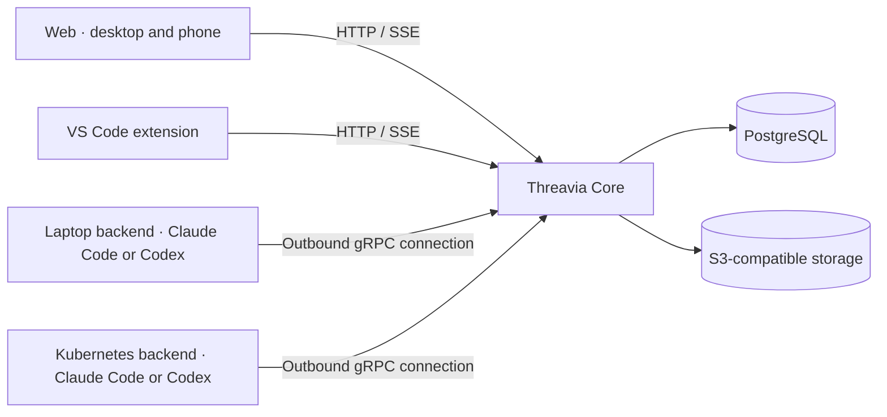

# Threavia

**Run coding agents on your own machines. Follow their work from the web or VS Code.**

Threavia is a self-hosted control plane for **Claude Code** and **Codex**. Start
work on a laptop or a Kubernetes backend, leave it running, and return from
another device to read the result, answer a question or approve an action.
Projects keep their tasks, decisions and history across conversations and providers.

[Get started](#get-started) · [Installation guide](docs/installation.md) ·
[Web and VS Code](#choose-your-view) · [Documentation](#documentation)

## Why use Threavia?

Coding agents can work for a long time, ask for permission while you are away,
and leave useful context scattered across terminals and conversations.
Threavia gives you one place to direct that work and keep its context.

| When you need to… | Threavia helps you… |
| --- | --- |
| Leave an agent working without keeping an editor open | Run it on a backend independently of your client. Closing a tab or VS Code does not stop execution. |
| Handle approvals away from your desk | See pending permissions and questions in the web client, including on a phone, and answer from either client. An answer is reflected in the other views. |
| Use several machines or providers | Choose the backend and working directory for each session, with its status and provider quotas visible. |
| Avoid repeating project context | Keep instructions, tasks, decisions, searchable history and Skills with the project. Share selected memory, known directories and Skills across your own projects. |
| Control what an agent can do | Set execution modes, capability switches and rules; review requests, inspect diffs, stop work and read its audit trail. |
| Pick up a long-running project later | Resume conversations, inspect published artifacts and schedule recurring session messages. |

For example: start a change from VS Code on your laptop, check its progress on
your phone, answer a permission request, then return to the editor to inspect
the diff. The same session and project context are available in both views.
The machine running the backend must stay available for execution to continue.

## How it works

A working installation has a **Core**, **at least one backend**, and a client.
You can put Core in Kubernetes and keep execution on a laptop; Kubernetes is
optional for both components.



- **Core** serves the web application and API, persists sessions and events in
  PostgreSQL, and stores artifacts and project Skill bundles in S3-compatible
  storage. Clients reconnect to the persisted state.
- **Backends** run the provider CLI where your code and tools live. Provider
  credentials and native provider sessions stay on the backend. Backends connect
  out to Core, so a laptop needs no inbound port.
- **Clients** show and control the same Core state. A web or editor disconnection
  does not cancel the running agent.

Files and tools available to an agent depend on its backend's operating-system
permissions. Execution policies provide controls and approvals; use OS or
container isolation when you need a security boundary. Backend changes are
explicit: Threavia does not silently move work or synchronize repositories.

## Get started

1. **Install Core** using one of the paths below.
2. **Connect a backend** on the machine where the agent should work. It needs
   Claude Code or Codex and its own authenticated provider account or API key.
3. **Open the web application or add Core in VS Code.** Create a project, choose
   the backend and working directory, review its permissions, and send a message.

| Installation path | Best suited to | Start here |
| --- | --- | --- |
| Docker Compose | Try Core locally or run it on a Docker host | [Local Docker setup](docs/installation.md#docker-compose) |
| Kubernetes / Helm | Run Core in a cluster with your existing database, storage and ingress | [Kubernetes setup](docs/installation.md#kubernetes--helm) |
| Release binaries | Run Core or a backend directly on Linux or macOS | [Binary installation](docs/installation.md#release-binaries) |
| Laptop or server backend | Work in existing checkouts with local tools and provider credentials | [Connect Claude Code or Codex](docs/installation.md#connect-a-backend) |
| Container or Kubernetes backend | Give execution its own persistent environment | [Container and cluster backends](docs/installation.md#container-and-kubernetes-backends) |
| Kubernetes execution | Separate Job and Monitor Pods for Claude and Codex | [Executor, storage and tests](docs/kubernetes-execution.md) |
| NixOS backend | Manage a backend as a system service | [NixOS modules](docs/nix.md) |

### Try Core with Docker

You need Docker with the Compose plugin and Git. From a clone of this repository:

```sh
git clone https://github.com/rclsilver/threavia.git
cd threavia
cp deploy/docker/compose.env.example .env.docker
# Edit .env.docker: choose a released version and set a database password.
docker compose --env-file .env.docker -p threavia -f deploy/docker/compose.yaml up -d
```

Open <http://localhost:8080>, then [connect a backend](docs/installation.md#connect-a-backend).
This example starts Core and PostgreSQL, publishes ports only on localhost and
keeps the database in a named volume. It uses no login and leaves object storage
disabled: **attachments, artifacts and Core-managed Skills need the
[S3 configuration](docs/installation.md#enable-artifacts-and-skills)**.

For remote access, configure authentication and TLS as described in the
[installation guide](docs/installation.md#remote-access-and-authentication).
The root `docker-compose.yml` is for source development; the example above
runs the published Core image.

## Choose your view

### Web — follow work from a desktop or phone

The web client is included in Core. Open Core's URL; there is no separate web
server to install. Its responsive layout works in a desktop or mobile browser.

- **Waiting** gathers questions and permission requests across projects.
- **Sessions** show the conversation, tools, progress, file changes and published
  artifacts. Markdown artifacts open as readable documents, including Mermaid
  diagrams, with a Source view for the original text. Queue a follow-up, steer or
  interrupt work when supported, or stop it.
- **Project views** manage tasks and dependencies, memory, instructions,
  directories, Skills, permissions and audit history.
- **Account settings** manage backends, the default backend, provider quotas,
  global memory and directories, and account audit history.

Use project instructions for standing rules, and pin important decisions so
agents receive them on future jobs. Global memory belongs to your account on
this Core; it is shared across your projects, rather than across users.

### VS Code — keep the conversation beside your code

Install **[Threavia from the VS Code Marketplace](https://marketplace.visualstudio.com/items?itemName=rclsilver.threavia)**:

```sh
code --install-extension rclsilver.threavia
```

You can also install the `.vsix` attached to a
[GitHub release](https://github.com/rclsilver/threavia/releases).
Open the Threavia activity-bar view, choose **Add a Core**, enter its URL and
sign in. You can connect several Cores at once.

- Follow sessions and answer approvals or questions in conversation editor tabs.
- Use **Ask Threavia About This…** on a file or selection to send code context.
- Open changed files and diffs, preview or save artifacts, and manage tasks,
  memory, directories, skills and permissions from the editor.
- See backend status and quotas, and keep pending requests visible in the sidebar
  and status bar.

The extension controls a backend; installing it does not start an agent on your
workstation or copy a remote backend's files into your workspace. See the
[VS Code guide](clients/vscode/README.md) for sign-in, commands and settings.

## Availability

The clients provided here are **Web and VS Code**. Use the responsive web client
on Android or iOS; native mobile and voice clients are not included. Projects
and account data are isolated per user; shared team projects and roles are not
provided. Backend selection is explicit, with no automatic scheduling or failover.

This README follows `master`. Packaged installations use tagged releases; open
the documentation at the matching tag for that version's features. Newer Core
and backend features can require updating both components; see the
[provider authentication and quota recovery guide](docs/provider-recovery.md).

## Documentation

| Guide | What you will find |
| --- | --- |
| [Installation](docs/installation.md) | Docker, Kubernetes, release binaries, backend registration, storage and authentication |
| [VS Code](clients/vscode/README.md) | Installation, sign-in, views, commands and several Cores |
| [Codex backend](docs/codex.md) | Provider setup, execution modes and supported features |
| [NixOS](docs/nix.md) | Backend packages and services |
| [MCP servers](docs/mcp.md) | Existing external servers, credentials, discovery and project/session selection |
| [Control over MCP](docs/control-mcp.md) | Pilot another Threavia with scoped accesses, session events and delegated permission decisions |
| [Skills](docs/skills.md) | Agent Skills support for Claude Code and Codex |
| [Session management](docs/session-management.md) | Coordinating and delegating work between sessions |
| [Provider recovery](docs/provider-recovery.md) | Authentication expiry, exhausted quotas and retry behavior |
| [Audit](docs/audit.md) · [Metrics](docs/metrics.md) | Activity records and operational monitoring |
| [Development and releases](docs/development.md) · [Contributing](CONTRIBUTING.md) | Build from source, tests and contribution workflow |
| [Architecture](docs/architecture.md) · [API](docs/api.md) · [Backend protocol](docs/protocol.md) | Technical contracts and implementation details |
| [Specification](THREAVIA_SPEC_V1.md) | The original V1 scope and acceptance criteria |

## License

[Apache License 2.0](LICENSE).
